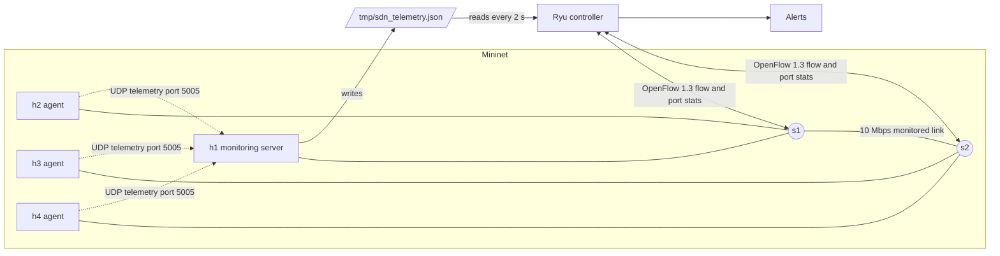

# SDN Network Monitoring and Alert System

Computer Networks mini project (SDN + Socket Programming, topic 6).
Hosts send telemetry over **UDP sockets** to a central monitoring server. A **Ryu SDN controller** polls the switches for flow and port statistics, combines them with the application telemetry, and raises alerts for abnormal conditions. Everything runs in **Mininet** on an Ubuntu VM.

## Team
| Member | GitHub | Responsibility |
|---|---|---|
| Person 1 | aaditiyan33 | (fill in) |
| Person 2 | (fill in) | (fill in) |
| Person 3 | (fill in) | (fill in) |

## Architecture
See [docs/architecture.md](docs/architecture.md).

- **Topology:** 4 hosts (h1-h4), 2 OpenVSwitch switches (s1, s2). h1-h2 on s1, h3-h4 on s2. The s1-s2 link is limited to 10 Mbps and is the monitored bottleneck.
- **h2, h3, h4** run UDP telemetry agents (`agents/udp_agent.py`). Each sends a JSON packet every second with host name, sequence number, timestamp and interface byte counters.
- **h1** runs the monitoring server (`server/monitor_server.py`), listening on UDP port 5005. It detects packet loss from sequence-number gaps and marks a host DOWN after 3 s of silence. It writes its state to `/tmp/sdn_telemetry.json`.
- **Ryu controller** (`controller/monitor_app.py`) extends the standard learning switch. Every 2 s it requests port and flow statistics from both switches, computes link utilization from byte-counter differences, reads the server's telemetry file, and prints alerts.

### Why a file connects the server and the controller
Mininet hosts live in separate network namespaces and cannot reach the controller process on the VM's `127.0.0.1`. The monitoring server writes its state to a file in `/tmp`, which the controller (running in the VM's main namespace) reads.

### Utilization formula
`utilization (%) = (delta_bytes * 8) / (delta_t * link_capacity_bps) * 100`

### Alert thresholds
| Condition | Threshold |
|---|---|
| Link utilization | above 80% of 10 Mbps |
| Telemetry packet loss | above 20% |
| Host silent | no telemetry for 3 s |

## Requirements
Ubuntu VM with Mininet 2.3.0, Open vSwitch, Python 3.9 (virtualenv for Ryu), Ryu 4.34, eventlet 0.30.2, iperf. See [setup.sh](setup.sh).

## How to run
Open two terminals.

**Terminal 2 (clean up first, then leave for later):**
```bash
cd ~/sdn-monitor
sudo mn -c
```

**Terminal 1 (controller):**
```bash
source ~/ryu-env/bin/activate
cd ~/sdn-monitor
ryu-manager controller/monitor_app.py
```

**Terminal 2 (network):**
```bash
cd ~/sdn-monitor
sudo python3 topology/topo.py
```

Never run `sudo mn -c` while Ryu is running (it kills Ryu). Always type `exit` in Mininet and press Ctrl+C in Ryu before closing the terminals.

## Tests
See [docs/test_cases.md](docs/test_cases.md). In brief, at the `mininet>` prompt:
mkdir -p docs
cat > docs/architecture.md << 'EOF'
# Architecture



## Communication flow
1. Agents on h2, h3 and h4 send a JSON telemetry packet over UDP to h1 once per second.
2. The monitoring server on h1 updates per-host counters (received, lost, status) and writes them to a shared JSON file.
3. The Ryu controller sends `OFPPortStatsRequest` and `OFPFlowStatsRequest` to both switches every 2 s.
4. From the port byte counters it computes link utilization, reads the telemetry file, and prints an alert when a threshold is crossed or a host goes silent.

## Message format (agent to server)
```json
{"host": "h2", "seq": 17, "ts": 1791700463.25, "rx_bytes": 123456, "tx_bytes": 98765}
```
