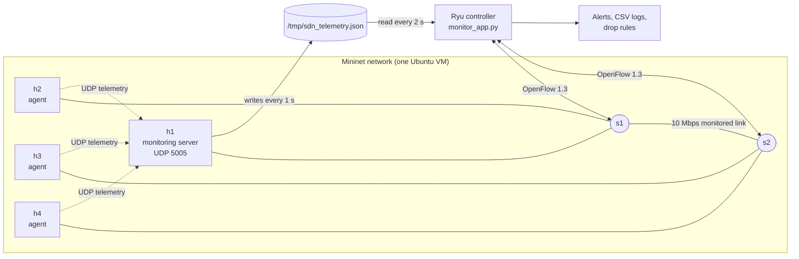
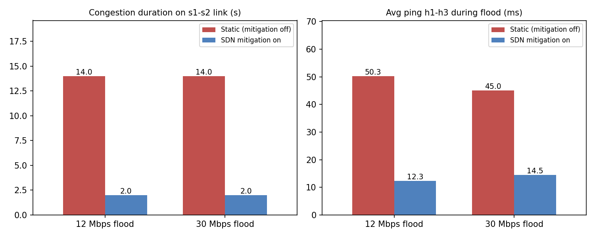
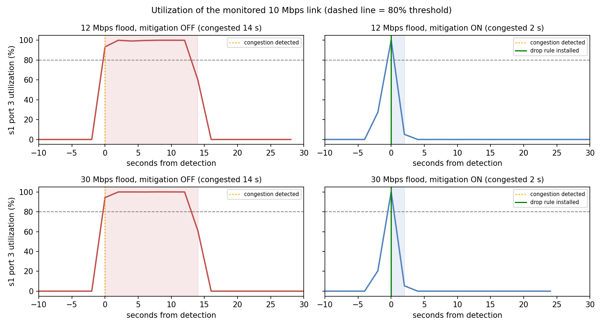
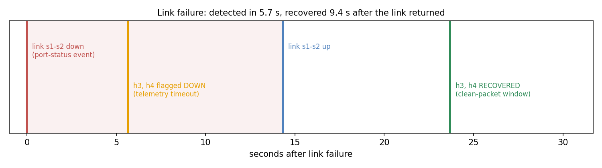

# SDN Network Monitoring and Alert System

Computer Networks mini project (SDN + Socket Programming, topic 6: Network Monitoring and Alert System, **UDP**).

Hosts send telemetry over **UDP sockets** to a central monitoring server. A **Ryu SDN controller** polls the switches for flow and port statistics, combines them with the application telemetry, raises alerts for abnormal conditions, and automatically blocks a flooding flow. Everything runs in **Mininet** on one Ubuntu VM.

## Team

| Member | GitHub | Responsibility |
|---|---|---|
| Person 1 | Aaditiyan | (fill in) |
| Person 2 | Aakash | (fill in) |
| Person 3 | Abhishek | (fill in) |

## What it does

| Requirement from the brief | Where it is |
|---|---|
| UDP telemetry agents | `agents/udp_agent.py` on h2, h3, h4 |
| Centralized monitoring server | `server/monitor_server.py` on h1 |
| SDN flow statistics | `controller/monitor_app.py` (port and flow stats every 2 s) |
| Traffic utilization | Computed from port byte counters (formula below) |
| Abnormality thresholds | Utilization, telemetry loss, host silence (table below) |
| Alert generation | Console alerts and `results/events_*.csv` |
| Multiple network nodes | 4 hosts, 2 switches |
| Presentation of results | Utilization logs and graphs in `results/` |
| Dynamic SDN response | Flooding flow is detected and blocked automatically |
| Challenging scenario | UDP flood congestion and inter-switch link failure |

## Architecture



- **Topology:** h1 and h2 on s1, h3 and h4 on s2. The s1-s2 link is limited to 10 Mbps and is the monitored bottleneck. Host links are 100 Mbps.
- **Agents (h2, h3, h4):** send a JSON datagram every second with host name, sequence number, timestamp and interface byte counters.
- **Monitoring server (h1):** listens on UDP 5005, detects loss from sequence gaps (last 10 packets), marks a host DOWN after 3 s of silence, and writes `/tmp/sdn_telemetry.json`.
- **Ryu controller:** extends the standard learning switch. Every 2 s it requests port and flow statistics, computes utilization, reads the telemetry file, and alerts or blocks.
- **Why a file joins server and controller:** Mininet hosts are in separate network namespaces and cannot reach the controller on the VM's `127.0.0.1`. The controller can read `/tmp`, so the server writes its state there.

Full detail, diagrams and design decisions: [docs/architecture.md](docs/architecture.md).

### Utilization

`utilization (%) = (delta_bytes x 8) / (delta_t x capacity_bps) x 100`

Capacity is 10 Mbps for the s1-s2 link ports and 100 Mbps for host ports.

### Alert thresholds

| Condition | Threshold |
|---|---|
| Link utilization | above 80% of port capacity |
| Telemetry packet loss | above 20% over the last 10 packets |
| Host silent | no telemetry for 3 s (host DOWN) |
| Flooding flow | heaviest flow above 2 Mbps, confirmed by the source host's telemetry |

### Dynamic response

When a port is congested, the controller finds the heaviest flow on that switch, checks the source host's telemetry, and installs a priority-100 **drop rule** for that source and destination for **20 s**. The rule expires on its own. Starting the controller with `MITIGATION=0` turns blocking off (alerts only), which is the static baseline for the evaluation.

## Requirements

Ubuntu VM with Mininet 2.3.0, Open vSwitch, Python 3.9 (virtualenv for Ryu), Ryu 4.34, eventlet 0.30.2, iperf. Install everything with [setup.sh](setup.sh). The plotting script also needs matplotlib and pandas (installed by `setup.sh`).

## How to run

Use two terminals. **Clean up first, because `sudo mn -c` also kills Ryu.**

**Terminal 2: clean up (before Ryu)**
```bash
cd ~/sdn-monitor
sudo mn -c
rm -f results/events_*.csv results/util_*.csv
```

**Terminal 1: controller**
```bash
source ~/ryu-env/bin/activate
cd ~/sdn-monitor
MITIGATION=1 ryu-manager controller/monitor_app.py     # MITIGATION=0 for the baseline
```
Wait for `=== Controller started, mitigation ON ===`.

**Terminal 2: network**
```bash
cd ~/sdn-monitor
sudo python3 topology/topo.py
```
Wait for `0% dropped (12/12 received)` and the `mininet>` prompt. Ryu should print `[FLOW]` lines every 2 s and no alerts.

**Shut down in this order:** Shut down in this order: type `exit` in Mininet, then press Ctrl+C in Ryu.
The event and utilization CSVs are appended to across runs. Copy them to `results/runs/` after each experiment and delete them before the next one.

## Tests and experiments

Type these at the `mininet>` prompt, one at a time. Mininet replaces a bare host name inside a command with its IP, so commands that contain host names in their arguments go through `py hX.cmd('...')`.

**Telemetry check**
```
h1 cat /tmp/sdn_telemetry.json
```

**UDP flood (12 Mbps shown; use `-b 30M` for the second condition)**
```
h3 iperf -s -u > /dev/null &
py h1.cmd('ping -c 15 -i 1 10.0.0.3 > /tmp/ping_12m.txt &')
h2 iperf -c 10.0.0.3 -u -b 12M -t 15
py print(h1.cmd('tail -2 /tmp/ping_12m.txt'))
```
Then wait about 6 s so the controller logs the end of the congestion.

**Link failure**
```
link s1 s2 down
link s1 s2 up
```
Wait about 20 s after `up` for the RECOVERED alerts.

The full test table is in [docs/test_cases.md](docs/test_cases.md).

## Results

Each condition below was run once (mitigation off, then on) on the same topology. Raw data is in `results/runs/`, and `python3 results/plot_results.py` rebuilds the table and graphs.

| Flood | Mitigation | Congestion on s1-s2 link | Avg ping h1-h3 | Max ping |
|---|---|---|---|---|
| 12 Mbps | off (static) | 14.0 s | 50.3 ms | 106.1 ms |
| 12 Mbps | on (SDN) | 2.0 s | 12.3 ms | 98.4 ms |
| 30 Mbps | off (static) | 14.0 s | 45.0 ms | 87.5 ms |
| 30 Mbps | on (SDN) | 2.0 s | 14.5 ms | 99.2 ms |

- Congestion is about 86% shorter with mitigation. The drop rule is installed in the same poll that detects the congestion.
- Average ping delay is about 68% (30 Mbps) to 76% (12 Mbps) lower during the attack.
- No alerts were raised during an idle run with no attack.
- **Link failure:** hosts behind the failed link were flagged DOWN 5.7 s after the link-down event, and reported RECOVERED 9.4 s after the link returned.





### Notes on interpreting the results

- Congestion duration is the most reliable metric. The 2.0 s with mitigation is one polling interval, because the end of congestion can only be logged at the next poll.
- Ping averages vary between repeats (standard deviation of 28 to 43 ms within a run), so read them as a trend. The maximum ping does not improve because it comes from the first 1 to 2 s before the rule is installed.
- iperf loss is not used as a metric. In the baseline the 10 Mbps link holds the sender back and loss shows 0%, and with mitigation the dropped flood means the server never sends its report.

## Limitations

- One run per condition.
- Mitigation drops the whole source-destination flow for 20 s, including any legitimate traffic between the same two hosts.
- The topology has a single path between the switches, so a link failure is detected and reported but not rerouted.
- The server and controller exchange data through a file, which works only on one machine.
- In the recorded runs the telemetry check always agreed with the flow evidence. The paths for stale telemetry and for disagreement were not exercised in Mininet.
- Port-status events are logged once per real state change; Mininet’s startup events are suppressed.
## Repository layout

```
agents/       UDP telemetry agent
server/       monitoring server
controller/   Ryu app (statistics, alerts, mitigation)
topology/     Mininet topology script
demo/         environment smoke test (Mininet + Ryu + UDP)
results/      summary.csv, graphs, plot_results.py
results/runs/ raw event, utilization and ping data for each experiment
docs/         architecture.md, test_cases.md
setup.sh      installs the dependencies
```
