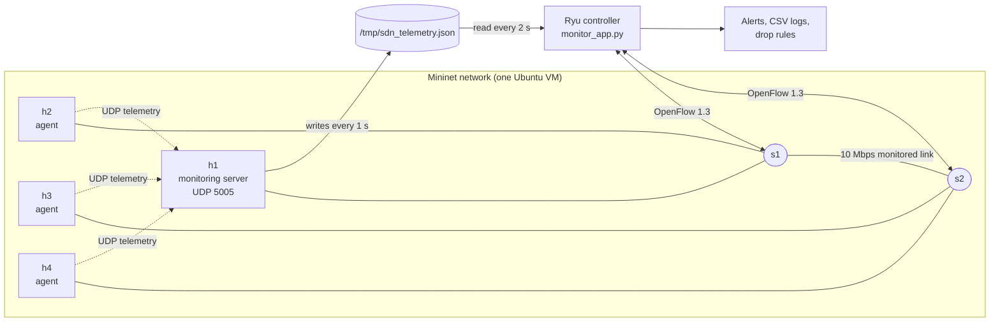
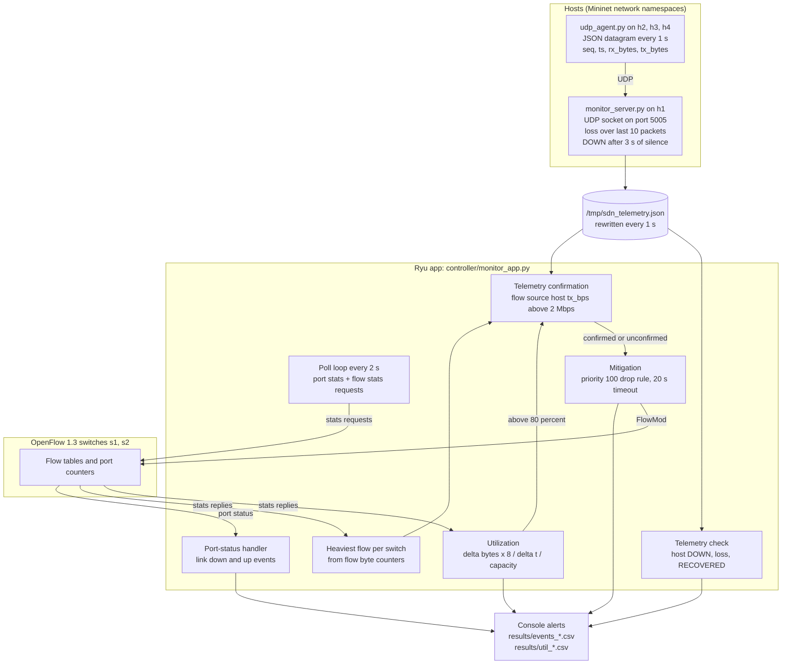
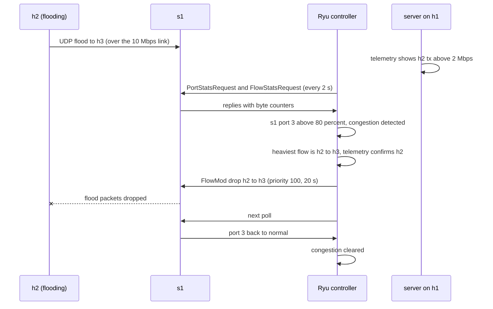

# Architecture

This document describes how the system is built, how the parts talk to each other, and why. For setup and run instructions see the [README](../README.md).

## 1. Overview

Hosts in a Mininet network send application telemetry over **UDP** to a central monitoring server. A **Ryu SDN controller** polls the OpenFlow switches for port and flow statistics, combines that network view with the application telemetry, raises alerts, and automatically blocks a flooding flow.



| Layer | What it contributes |
|---|---|
| Application (UDP sockets) | Per-host view: who is sending how much, who is alive, how many telemetry packets were lost |
| Network (OpenFlow statistics) | Per-link view: how full each port is, which flow is heaviest, when a link goes down |
| Controller (Ryu) | Combines both views, decides whether something is abnormal, and acts on it |

## 2. Components

| Component | File | Runs on | Role |
|---|---|---|---|
| Telemetry agent | `agents/udp_agent.py` | h2, h3, h4 (one process each) | Sends one JSON datagram per second to the server |
| Monitoring server | `server/monitor_server.py` | h1 | Receives datagrams, tracks per-host status and loss, writes a snapshot file |
| SDN controller app | `controller/monitor_app.py` | VM (outside Mininet), port 6653 | Learning switch plus monitoring, alerting and mitigation |
| Topology | `topology/topo.py` | VM (root) | Builds the network, starts the server and agents, opens the Mininet CLI |
| Plotting | `results/plot_results.py` | any machine | Builds the summary table and graphs from `results/runs/` |

## 3. Topology

```
 h1 (10.0.0.1)  h2 (10.0.0.2)          h3 (10.0.0.3)  h4 (10.0.0.4)
      |p1            |p2                    |p1            |p2
      +------ s1 ----+                      +------ s2 ----+
                     |p3                         p3|
                     +-------- 10 Mbps ----------+
```

| Switch | Port 1 | Port 2 | Port 3 |
|---|---|---|---|
| s1 | h1 | h2 | s2 (10 Mbps) |
| s2 | h3 | h4 | s1 (10 Mbps) |

- Host links are 100 Mbps. The single s1-s2 link is limited to 10 Mbps and is the monitored bottleneck.
- Hosts have fixed MAC addresses `00:00:00:00:00:01` to `...04` (h1 to h4), so the controller can map a flow's source MAC to a host name.
- Switches use OpenFlow 1.3 and connect to a remote controller at `127.0.0.1:6653`.

## 4. Communication paths

1. **Telemetry (UDP).** Each agent sends a datagram to `10.0.0.1:5005` once per second. UDP is connectionless, so one server socket serves all agents.
2. **Statistics (OpenFlow).** Every 2 s the controller sends `OFPPortStatsRequest` and `OFPFlowStatsRequest` to both switches and processes the replies.
3. **Events (OpenFlow).** Switches push port-status messages to the controller when a link goes down or comes up.
4. **Control (OpenFlow).** To mitigate, the controller sends an `OFPFlowMod` that installs a drop rule.
5. **Server to controller (file).** The server writes `/tmp/sdn_telemetry.json` every second and the controller reads it on every poll.

### Why a file connects the server and the controller

Mininet hosts live in separate network namespaces. The server on h1 cannot reach the controller process through the VM's `127.0.0.1`. The controller runs in the VM's main namespace and can read `/tmp`, which the hosts share with it. The server writes to a temporary file and renames it (`os.replace`), so the controller never reads a half-written file. This is the simplest reliable bridge in a single-VM setup. A production design would use a socket or REST call instead.

## 5. Message format (agent to server)

```json
{"host": "h2", "seq": 17, "ts": 1791700463.25, "rx_bytes": 123456, "tx_bytes": 98765}
```

| Field | Meaning |
|---|---|
| `host` | Name of the sending host |
| `seq` | Sequence number, starting at 0 and increasing by 1; gaps mean lost datagrams |
| `ts` | Sender timestamp (seconds since epoch) |
| `rx_bytes`, `tx_bytes` | Interface byte counters read from `/proc/net/dev` on the host's own interface |

The server turns two consecutive `tx_bytes` and `ts` values into `tx_bps`, the host's transmit rate.

## 6. Monitoring server logic

- **Receive loop** (main thread): `recvfrom` on a UDP socket, parse JSON, ignore malformed datagrams (`ValueError`, `KeyError`).
- **Writer thread:** every 1 s it takes a snapshot under a lock and writes the JSON file. The lock protects the shared per-host table.
- **Loss detection:** a gap in `seq` counts as lost packets. Loss percentage is computed over a **sliding window of the last 10 packets**, so it reflects the current state, not the whole run.
- **Host status:** a host is `down` if nothing has arrived for 3 s.
- **Agent restart:** if `seq` goes backwards, the server resets that host's sequence tracking.

Snapshot entry per host: `status`, `received`, `lost`, `loss_pct`, `tx_bps`, `last_seen`.

## 7. Controller logic



### 7.1 Utilization

`utilization (%) = (delta_bytes x 8) / (delta_t x capacity_bps) x 100`

The byte counter is the port's `tx_bytes`, compared between two consecutive polls. Capacity is chosen per port: 10 Mbps for `s1 port 3` and `s2 port 3` (the inter-switch link), 100 Mbps for host ports.

### 7.2 Thresholds

| Condition | Threshold | Source |
|---|---|---|
| High utilization | above 80% of port capacity | Port statistics |
| Telemetry loss | above 20% over the last 10 packets | Monitoring server |
| Host silent | no telemetry for 3 s (host marked DOWN) | Monitoring server |
| Flooding flow | heaviest flow above 2 Mbps on a congested switch | Flow statistics |
| Telemetry confirmation | the flow's source host reports `tx_bps` above 2 Mbps | Monitoring server |
| Stale telemetry | host's last packet older than 5 s | Monitoring server |

### 7.3 Combining flow statistics with telemetry

When a port is congested, the controller finds the heaviest flow on that switch from the flow byte counters, maps its source MAC to a host, and checks that host's own telemetry:

| Verdict | Condition | Action |
|---|---|---|
| `confirmed` | Host's telemetry `tx_bps` above 2 Mbps | Alert "confirmed by telemetry", then block |
| `unconfirmed` | Telemetry stale, host down, or missing | Alert "UNCONFIRMED", block on flow evidence |
| `disagree` | Host's telemetry rate is low | Alert only, **do not block** |

Two independent sources agreeing before an automatic response lowers the chance of blocking the wrong flow. In the recorded Mininet runs every blocked flow was `confirmed`. The `unconfirmed` and `disagree` branches were not exercised in Mininet.

### 7.4 Dynamic response (mitigation)



- The rule matches `eth_src` and `eth_dst` of the heaviest flow, has an empty instruction list (drop), priority 100 (above the learned rules at priority 1), and `hard_timeout = 20 s`.
- The rule expires by itself. If the flood continues, it is installed again at the next poll after expiry.
- `MITIGATION=0` disables blocking but keeps all alerts and logging. This is the static baseline used in the evaluation.

### 7.5 Link failure

Port-status events give an immediate "link down on sX port N" alert and a `port_down` row in the log. The hosts behind the failed link stop sending telemetry, so after about 3 s the server marks them DOWN and the controller raises a host alert. When the link returns, telemetry resumes and the sliding window refills. The host is reported RECOVERED once loss drops back to 20% or below, which takes about 8 clean packets.

Open vSwitch can send several port-status messages for one link transition, so the controller remembers each port's last state and logs only real changes. Each failure therefore appears as one `port_down` per port, and each recovery as one `port_up` per port. Detection time is the first `host_down` minus the first `port_down`, and recovery time is `host_recovered` minus the last `port_up`.

## 8. Failure handling

| Situation | What happens |
|---|---|
| Malformed datagram | Ignored by the server |
| Telemetry packets lost | Detected from sequence gaps and reported as loss over the last 10 packets |
| Agent stops or host unreachable | Host marked DOWN after 3 s, RECOVERED when telemetry is clean again |
| Agent restarts | Sequence reset detected; tracking restarts |
| Link down | Immediate port-status alert; hosts behind it flagged DOWN |
| Link flood | Detected within one 2 s poll, flow blocked for 20 s |
| Telemetry file missing or unreadable | Controller skips telemetry checks for that poll |

## 9. Output files

| File | Content |
|---|---|
| `results/events_on.csv`, `events_off.csv` | Timestamped events. Types: `controller_start`, `congestion_start`, `congestion_cleared`, `mitigation_installed`, `host_down`, `host_recovered`, `port_down`, `port_up`. `host_down` is also used for loss alerts. |
| `results/util_on.csv`, `util_off.csv` | `time, switch, port, util_pct` for every port at every poll |

The `on` or `off` in the name matches `MITIGATION`. Files are appended to across runs, so copy them away between experiments (see the README).

## 10. Design decisions and limits

| Decision | Reason | Limit |
|---|---|---|
| File bridge between server and controller | Namespaces prevent a direct connection; simple and robust | Not a networked design; only works on one machine |
| Poll every 2 s | Low overhead, enough for a 10 Mbps link | Detection resolution is 2 s; measured congestion cannot be shorter than one poll |
| Drop the whole flow | Simple, effective, and "blocking" is a recognised response | Also blocks legitimate traffic from the same source to the same destination for 20 s |
| Sliding loss window of 10 | Reacts quickly in both directions | Short window; a few lost packets can swing the percentage |
| Single path between switches | Keeps the topology small | A link failure is detected and reported, but traffic cannot be rerouted |
